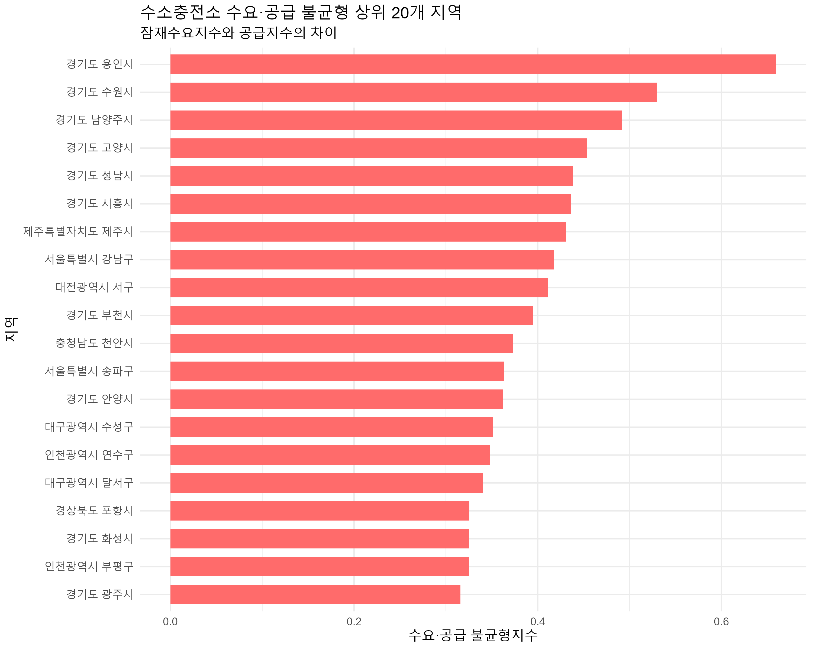
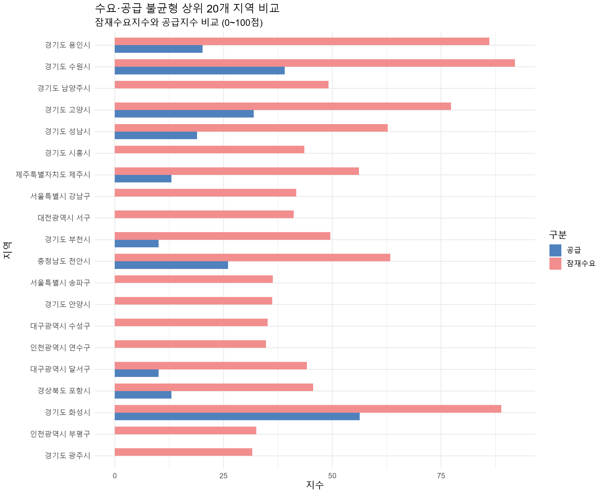
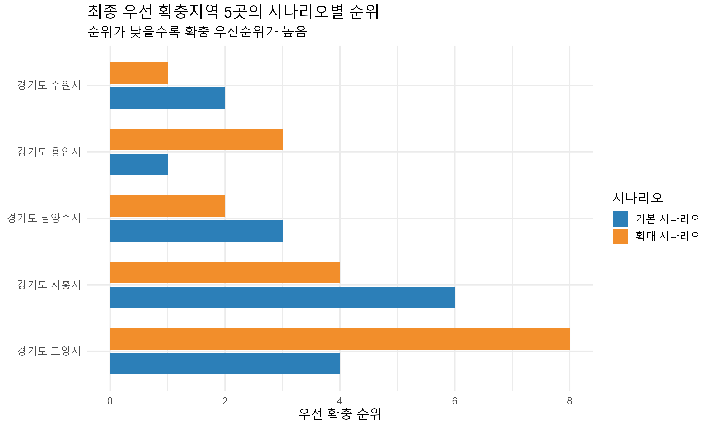
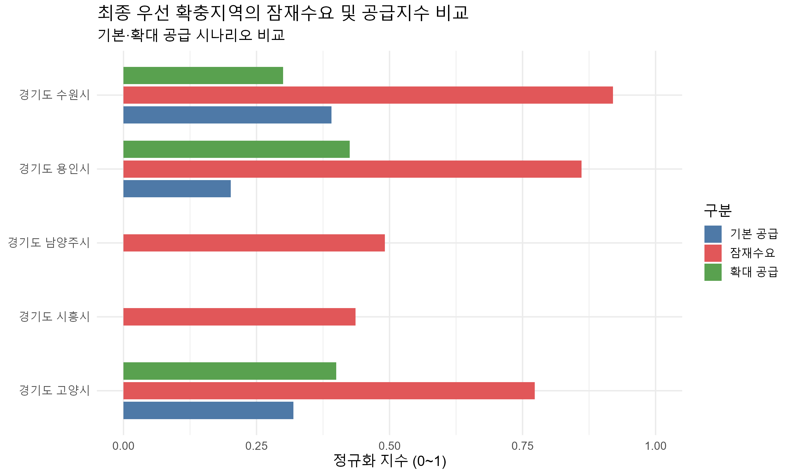
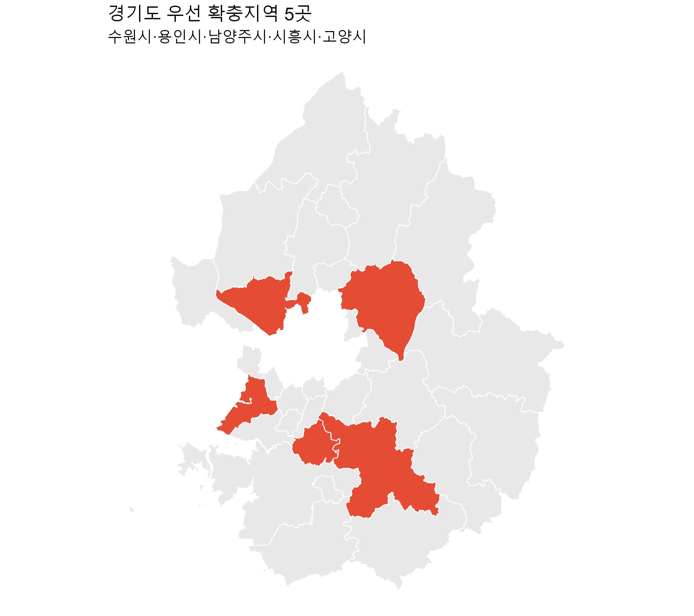
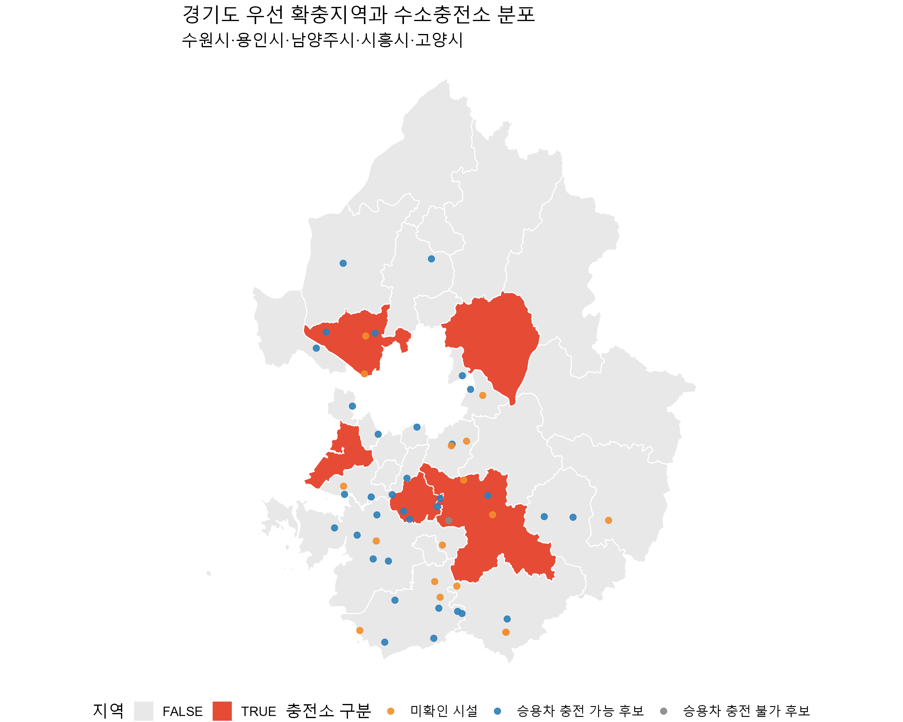

# 자가용 수소승용차의 미래 잠재수요 분석을 통한 충전 인프라 불균형 진단 및 우선 확충지역 선정

**팀명:** 레전드레전드  
**분석 도구:** R, RStudio, GitHub  
**분석 대상:** 전국 252개 지역의 공급 현황 및 228개 공통 지역의 수요·공급 불균형

---

## 1. 프로젝트 소개

본 프로젝트는 자가용 수소승용차의 미래 잠재수요와 기존 수소충전 인프라의 공급 수준을 비교하여 지역별 수요·공급 불균형을 진단하고, 충전소 우선 확충이 필요한 지역을 선정하는 데이터 분석 프로젝트입니다.

기존 수소승용차 등록대수나 충전소 설치 현황만으로는 향후 수소승용차 이용 가능성이 높은 지역의 충전 인프라 필요성을 충분히 파악하기 어렵습니다.

이에 본 연구에서는 자가용 승용차 등록대수와 승용차 발생통행량을 활용하여 미래 잠재수요를 나타내는 상대적 지표를 구축하고, 승용차 충전 가능 충전소 수 및 충전기 수를 활용한 공급지수와 비교하였습니다.

또한 충전 가능 여부가 불명확한 시설을 고려한 민감도 분석을 수행하여 최종 우선 확충지역 5곳을 선정하였습니다.

## 2. 연구 목적

- 자가용 수소승용차의 지역별 미래 잠재수요 분석
- 기존 수소충전 인프라의 공급 수준 평가
- 지역별 수요·공급 불균형 진단
- 충전 가능 여부에 따른 공급 시나리오별 민감도 분석
- 충전 인프라 우선 확충지역 5곳 선정
- 데이터 기반 충전 인프라 확충 정책의 기초자료 제공

본 연구는 미래 수소승용차 보급대수나 충전수요를 직접 예측하는 것이 아니라, 지역별 상대적 잠재수요와 충전 인프라 확충 필요성을 평가하는 것을 목적으로 합니다.

## 3. 활용 데이터

| 데이터 | 제공기관 | 기준 시점 | 활용 목적 |
|---|---|---|---|
| 자동차등록현황보고 자동차등록대수현황 | 국토교통부 | 2026년 8월 | 자가용 승용차 등록대수 분석 |
| 승용차 발생통행량(OD) | 한국교통연구원 국가교통DB센터 | 2024년 | 지역별 승용차 발생통행량 산출 |
| KTDB 교통존 코드표 | 한국교통연구원 국가교통DB센터 | 2024년 | 교통존과 행정구역 매핑 |
| 수소충전소 현황 | 한국가스안전공사 | 2026년 8월 31일 | 충전소 현황 및 위치 분석 |
| 수소충전소 충전가능차량 및 가능대수 | 한국가스기술공사 | 2024년 12월 31일 | 승용차 충전 가능 여부 검토 |
| 수소충전소 관련 현황 | 한국석유관리원 | 2026년 | 충전소 정보 비교·검증 |

**데이터 출처**

- 국토교통부 자동차등록 통계: https://stat.molit.go.kr/
- 국가교통DB(KTDB): https://www.ktdb.go.kr/
- 공공데이터포털: https://www.data.go.kr/

서로 다른 기준연도의 데이터를 활용하였으므로 분석 결과는 동일 시점의 관측값이나 미래 수요의 정확한 예측값으로 해석하지 않습니다.

## 4. 분석 과정 및 방법

### STEP 1. 데이터 수집 및 전처리

**수요 데이터**

- 2026년 8월 기준 자가용 승용차 등록대수 추출
- 시도별 합계 행 제거 및 행정구역 기준 통일
- 2024년 KTDB 승용차 OD 자료에서 출발지 기준 발생통행량 산출
- 교통존 코드표를 활용한 시군구 단위 데이터 정리

**공급 데이터**

- 2026년 수소충전소 현황에서 연구용 시설 제외
- 상업용 충전소를 대상으로 공급 현황 분석
- 2024년 충전 가능 차량 자료와 충전소 정보 매칭
- 2026년 한국석유관리원 자료를 활용한 명칭·주소·좌표 비교
- 승용차 충전 가능 후보, 충전 불가 후보, 미확인 시설 구분

### STEP 2. 잠재수요지수 산출

자가용 승용차 등록대수와 승용차 발생통행량에 최소-최대 정규화(Min-Max Normalization)를 적용하여 0~1 범위로 변환하였습니다.

**잠재수요지수**

\[
D_i = 0.5C_i + 0.5T_i
\]

- \(D_i\): 지역 \(i\)의 잠재수요지수
- \(C_i\): 정규화된 자가용 승용차 등록대수
- \(T_i\): 정규화된 승용차 발생통행량

두 변수에 동일한 가중치(50:50)를 부여하였으며, 가중치 변화에 따른 민감도 분석도 수행하였습니다.

가중치 비교 시나리오는 70:30, 50:50, 30:70입니다.

### STEP 3. 공급지수 산출

승용차 충전 가능 후보 충전소 수와 충전기 수를 활용하여 지역별 공급지수를 산출하였습니다.

**공급지수**

\[
S_i = 0.5N_i + 0.5H_i
\]

- \(S_i\): 지역 \(i\)의 공급지수
- \(N_i\): 정규화된 승용차 충전 가능 후보 충전소 수
- \(H_i\): 정규화된 승용차 충전 가능 후보 충전기 수

공급지수가 높을수록 상대적으로 충전 인프라가 많이 확보된 지역으로 해석하였습니다.

### STEP 4. 수요·공급 불균형 분석

잠재수요지수와 공급지수의 차이를 이용하여 수요·공급 불균형지수를 산출하였습니다.

\[
G_i = D_i - S_i
\]

- \(G_i\): 수요·공급 불균형지수
- \(D_i\): 잠재수요지수
- \(S_i\): 공급지수

불균형지수가 높을수록 잠재수요 대비 충전 인프라 공급이 상대적으로 부족한 지역으로 판단하였습니다.

수요와 공급 자료가 공통으로 확보된 228개 지역을 대상으로 불균형지수를 산출하고, 상위 20개 지역을 추출하였습니다.

### STEP 5. 공급 시나리오 민감도 분석

충전 가능 여부가 미확인된 시설이 분석 결과에 미치는 영향을 검토하기 위해 두 가지 공급 시나리오를 비교하였습니다.

| 구분 | 내용 |
|---|---|
| 기본 시나리오 | 승용차 충전 가능 후보 시설만 반영 |
| 확대 시나리오 | 승용차 충전 가능 후보 및 미확인 시설 반영 |

각 시나리오에서 공급지수와 불균형지수를 다시 계산하고 지역별 우선순위 변화를 비교하였습니다.

### STEP 6. 최종 우선 확충지역 선정

기본 시나리오와 확대 시나리오의 순위 중 더 낮은 우선순위를 나타내는 값을 보수적 순위로 설정하였습니다.

\[
R_i = \max(R_{i,basic}, R_{i,expanded})
\]

보수적 순위가 낮은 지역을 우선 선정하고, 순위가 같은 경우 기본 시나리오와 확대 시나리오 순위를 차례로 비교하여 최종 5개 지역을 선정하였습니다.

## 5. 주요 분석 결과

### 5.1. 수소충전소 공급 현황

2026년 8월 31일 기준 수소충전소 현황 원자료 278개 시설 중 연구용 충전소 17개를 제외한 261개 상업용 충전소를 공급 분석 대상으로 설정하였습니다.

| 항목 | 분석 결과 |
|---|---:|
| 원자료 수소충전소 | 278개 |
| 연구용 충전소 | 17개 |
| 상업용 충전소 | 261개 |
| 공급 분석 대상 지역 | 252개 |
| 공급지수 0인 지역 | 134개 |
| 공급지수가 양수인 지역 | 118개 |

공급지수가 0인 지역은 분석 기준상 승용차 충전 가능 공급이 확인되지 않은 지역이며, 실제로 충전소가 전혀 존재하지 않는다는 의미는 아닙니다.

### 5.2. 수요·공급 불균형 상위 지역

잠재수요지수와 공급지수의 차이를 통해 충전 인프라 공급이 상대적으로 부족한 지역을 확인하였습니다.

### 5.3. 잠재수요와 공급지수 비교

불균형 상위 지역을 대상으로 잠재수요지수와 공급지수를 비교하여 지역별 차이를 시각화하였습니다.

### 5.4. 최종 우선 확충지역 5곳

기본·확대 시나리오의 불균형 순위를 종합하여 다음 5개 지역을 선정하였습니다.

| 최종 우선순위 | 지역 |
|---|---|
| 1 | 경기도 수원시 |
| 2 | 경기도 용인시 |
| 3 | 경기도 남양주시 |
| 4 | 경기도 시흥시 |
| 5 | 경기도 고양시 |

### 5.5. 우선 확충지역 지도 시각화

선정된 5개 지역을 경기도 지도에 표시하고 기존 수소충전소 분포와 비교하였습니다.

최종 선정지역은 구체적인 충전소 설치 부지가 아니라, 향후 현장조사와 추가적인 입지 분석이 필요한 우선 확충 검토지역입니다.

## 6. 분석 환경 및 실행 방법

**사용 환경**

- R / RStudio
- 주요 데이터 처리 패키지: `dplyr`, `readr`, `tidyr`
- 시각화 패키지: `ggplot2`
- 공간 분석 패키지: `sf`, `geodata`
- 버전 관리: Git / GitHub

## 7. 정책 제안 및 기대효과

본 연구는 수소승용차 잠재수요와 충전 인프라 공급 수준을 함께 고려하여 지역별 우선 확충 필요성을 평가하였습니다.

분석 결과는 다음과 같은 정책적 활용 가능성을 제시합니다.

- 잠재수요가 높고 공급이 부족한 지역의 신규 충전소 확충 검토
- 기존 충전소가 존재하는 지역의 충전기 증설 및 운영 효율 개선
- 선정지역의 교통 접근성, 부지 확보 가능성, 기존 충전소 운영 현황을 고려한 추가 입지 분석
- 충전소별 위치, 충전기 수, 충전 가능 차량 및 운영 상태의 통합 관리체계 마련
- 충전 인프라 구축 예산의 효율적인 배분을 위한 의사결정 지원

## 8. AI 활용

본 연구에서는 OpenAI의 ChatGPT를 데이터 분석 보조 도구로 활용하였습니다.

주요 활용 범위는 R 코드 작성 및 수정, 데이터 전처리 오류 해결, 분석 방법 검토, 결과 해석 및 시각화 지원입니다.

분석 결과는 공공데이터를 기반으로 산출하였으며, AI는 분석 과정의 코드 구현과 검토를 지원하는 역할로 활용하였습니다.

---

**팀명:** 레전드레전드  
**프로젝트:** AI와 함께하는 교통문제 해결을 위한 데이터 분석 공모전  
**GitHub:** https://github.com/seobin0606/jeonseo

